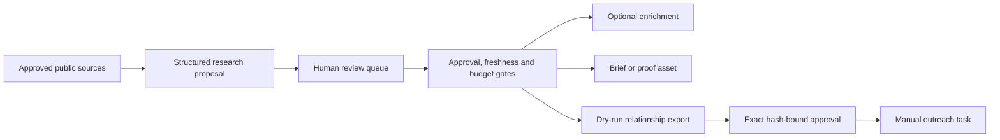

# Target Intelligence

**A sanitized engineering case study for evidence-led company discovery and human-reviewed outreach preparation.**

The original product helps an operator move from venture-capital portfolio research to a prioritized company workspace, evidence-backed hypotheses and manually approved outreach tasks. This public edition focuses on the hardest reusable engineering problem: ensuring that research, enrichment and exports cannot silently bypass human review.

No client records, contact details, credentials, provider responses or production fixtures are included.

## Workflow



## What this repository demonstrates

- Approval bound to an exact entity, version, content hash and purpose.
- Freshness tracked separately from approval.
- Budget gates before optional contact enrichment.
- Conflict checks before a prospect can be approved.
- Independent QA plus exact approval before an asset is released.
- Dry-run exports bound to the exact reviewed batch hash.
- Idempotency protection for retried commands.
- Deterministic priority scoring with visible inputs.

## Run the case study

```bash
npm install
npm test
npm run typecheck
```

## Repository boundary

This is intentionally not a deployable copy of the private application. It is a focused, testable extraction of the policy layer and architecture, published to demonstrate the product and engineering decisions without exposing proprietary research or personal data.

